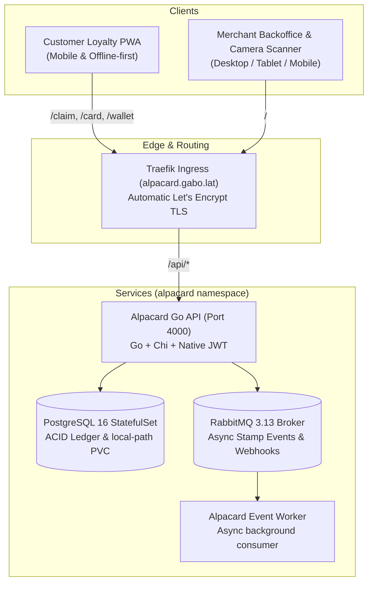

# Alpacard 🦙

> **Open-Source Digital Loyalty Punch Cards & Menus for Local Businesses.**  
> Self-hosted, decoupled, ultra-lightweight, and zero SaaS subscription fees.

[](https://opensource.org/licenses/MIT)
[](https://go.dev/)
[](https://react.dev/)
[](https://developer.mozilla.org/en-US/docs/Web/Progressive_web_apps)
[](https://k3s.io/)
[](CONTRIBUTING.md)

---

## 🚀 Live Demo

- **Merchant Portal & Scanner**: [https://alpacard.gabo.lat](https://alpacard.gabo.lat)
- **Interactive Live Demo**: [https://alpacard.gabo.lat/demo](https://alpacard.gabo.lat/demo)
- **Customer Mobile Wallet**: [https://alpacard.gabo.lat/wallet](https://alpacard.gabo.lat/wallet)

---

## ✨ Features

- 📱 **Zero App-Store Friction for Customers**:
  - Customers scan a counter QR code directly with their standard phone camera.
  - Generates an instant, anonymous guest wallet PWA—no app download or email signup required while waiting in line.
  - Customers can optionally register anytime to sync cards across all their devices.

- 🎨 **Deep Card Personalization**:
  - Custom merchant logos, brand color presets (Espresso Roast, Charcoal Slate, Forest Matcha, etc.), and custom hex colors.
  - Background image uploading with fit modes: `contain` (centered), `cover` (full bleed), or `watermark` with custom base tints.
  - Custom stamp icons: `coffee`, `star`, `sparkle`, `heart`, `gift`, `cupcake`, `crown`, and `tag`.

- 📖 **Integrated Business Menus**:
  - Link directly to external drive/website menus.
  - Upload 10MB PDF or image menus with in-wallet viewer.
  - Built-in interactive digital menu builder with categorized items and price tags.
  - One-tap `[ 📖 Ver Menú ]` button directly visible on the customer's punch card.

- 🔒 **Tamper-Proof Single-Use Anti-Replay Tokens**:
  - Dynamic QR codes generated with rotating 5-minute cryptographic tokens.
  - Atomic PostgreSQL transactions prevent token replay attacks or duplicate stamps.

- 📷 **Universal Camera Scanner**:
  - Cashiers and baristas scan customer QR codes using any device with a camera (phone, tablet, or web scanner) with instant sound and haptic confirmation.

- 🏢 **Multi-Merchant Wallet**:
  - Customers keep cards from all their favorite local coffee shops, bakeries, and stores organized in one clean wallet.

---

## 🏛️ Architecture Overview

Alpacard is built as a high-performance **Turborepo monorepo**:

```
alpacard/
├── apps/
│   ├── api/             # High-performance Go REST API & RabbitMQ consumer (~20MB RAM)
│   ├── web/             # Merchant Backoffice, Design Studio & QR Scanner (Vite + React)
│   └── wallet/          # Customer Mobile PWA (Offline-first, 1-click claim, dynamic QR)
├── packages/
│   └── shared/          # Shared TypeScript models, themes, and card presets
├── deploy/
│   ├── docker-compose.yml # 1-command local development stack (Postgres + RabbitMQ + Apps)
│   └── helm/alpacard/   # Helm chart for Kubernetes / k3s
└── docs/
    └── marketing/       # Free community marketing guides, Reddit posts, and launch calendar
```



---

## 💻 Local Quickstart

### 1-Command Docker Compose (Full Stack)

```bash
docker compose -f deploy/docker-compose.yml up --build
```

- **Merchant Backoffice**: [http://localhost:5173](http://localhost:5173)
- **Customer Wallet**: [http://localhost:5174](http://localhost:5174)
- **Go REST API**: [http://localhost:4000](http://localhost:4000)
- **RabbitMQ Dashboard**: [http://localhost:15672](http://localhost:15672) (`guest` / `guest`)

---

## 🤝 Contributing & Community

We are actively seeking collaborators, beta testers, and community maintainers!

- **Developers**: Check out [CONTRIBUTING.md](CONTRIBUTING.md) for local dev setup, good first issues, and PR guidelines.
- **Beta Testers & QA**: Test our camera QR scanner on different phones and report bugs using our [Issue Templates](.github/ISSUE_TEMPLATE/).
- **Local Business Outreach**: Check [docs/marketing/](docs/marketing/) for launch posts, Reddit templates, and local store pitch scripts.

---

## 📄 License

MIT License. Free for personal, commercial, and self-hosted use.
