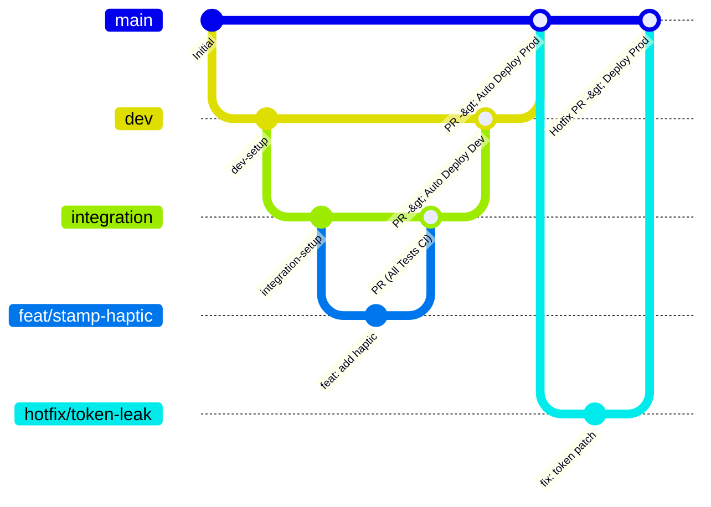
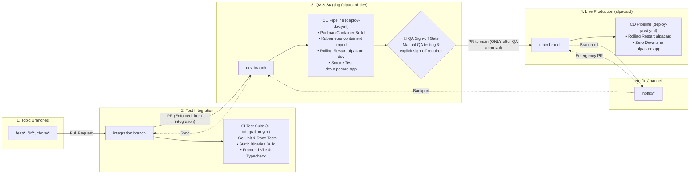
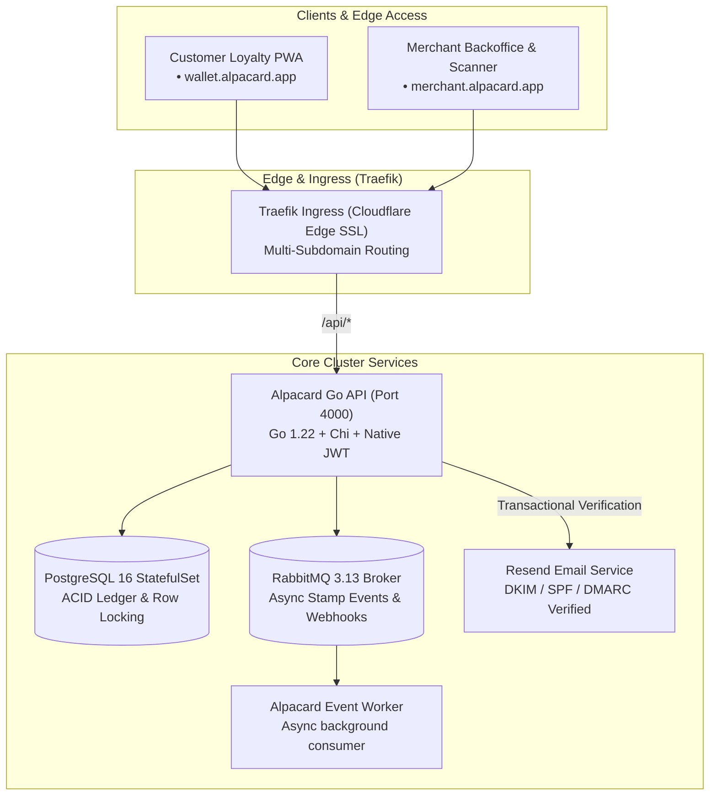

# Alpacard 🦙

> **Open-Source Digital Loyalty Punch Cards & Menus for Local Businesses.**  
> Self-hosted, decoupled, ultra-lightweight, and zero SaaS subscription fees.

[](LICENSE)
[](https://go.dev/)
[](https://react.dev/)
[](https://developer.mozilla.org/en-US/docs/Web/Progressive_web_apps)
[](https://kubernetes.io/)
[](CONTRIBUTING.md)

---

## 🌐 Environments & Domains

Alpacard features symmetrical, role-isolated subdomain routing across both Production and Development for clean brand separation and security boundary isolation:

| Environment | Purpose | Target Audience | URLs & Access Points | Security & Infrastructure |
| :--- | :--- | :--- | :--- | :--- |
| **Production** | Live Merchant & Customer traffic | Coffee shops, retail merchants & cardholders | • **Landing & Portal**: [https://alpacard.app](https://alpacard.app)<br/>• **Dedicated Merchant Console**: [https://merchant.alpacard.app](https://merchant.alpacard.app)<br/>• **Dedicated Customer Wallet**: [https://wallet.alpacard.app](https://wallet.alpacard.app)<br/>• **Interactive Live Demo**: [https://demo.alpacard.app](https://demo.alpacard.app)<br/>• **REST API**: `https://alpacard.app/api` | Public internet, Cloudflare Edge proxy with Universal SSL (`*.alpacard.app`), Traefik Ingress on Kubernetes, isolated PostgreSQL 16 ACID ledger with daily automated snapshots, RabbitMQ event broker. |
| **Development / Non-Prod** | Pre-release testing, staging & QA validation | Core engineering, QA testers, beta merchants | • **Unified Dev Console**: [https://dev.alpacard.app](https://dev.alpacard.app)<br/>• **Dedicated Dev Merchant**: [https://dev-merchant.alpacard.app](https://dev-merchant.alpacard.app)<br/>• **Dedicated Dev Wallet**: [https://dev-wallet.alpacard.app](https://dev-wallet.alpacard.app)<br/>• **Dedicated Dev Demo**: [https://dev-demo.alpacard.app](https://dev-demo.alpacard.app)<br/>• **Dev REST API**: `https://dev.alpacard.app/api`<br/>• *(Local fallback)*: `http://dev.alpacard.local` | Cloudflare Edge proxy with Universal SSL (`*.alpacard.app`), automated Let's Encrypt TLS multi-SAN certificates (`alpacard-dev-tls`), isolated Kubernetes namespace (`alpacard-dev`), isolated database (`alpacard_dev`), and RabbitMQ broker. |

---

## 📚 Project Documentation & Wiki

Alpacard includes an exhaustive engineering and operational wiki in the [`wiki/`](wiki/Home.md) directory, also accessible on the GitHub repository:

* **[📖 Wiki Home & Directory](wiki/Home.md)**: Central landing page and technology matrix.
* **[🏗️ System Architecture](wiki/Architecture-Overview.md)**: Deep dive into decoupled Go microservices, React frontends, and RabbitMQ message flows.
* **[🔐 Cryptographic Security & Anti-Fraud](wiki/Cryptographic-Security-and-Anti-Fraud.md)**: JTI single-use nonces, rotating dynamic QR HMAC signatures, and database row-level locking.
* **[📊 API Reference & Data Models](wiki/API-Reference-and-Data-Models.md)**: Full REST endpoints, PostgreSQL table DDLs, and RabbitMQ event envelopes.
* **[🛠️ Local Development Guide](wiki/Getting-Started-and-Local-Development.md)**: Monorepo workspace setup, Turborepo commands, Go toolchain, and Docker Compose stack.
* **[🌿 Branching Strategy & CI/CD](wiki/Branching-Strategy-and-CICD.md)**: Gitflow promotion lifecycle, gatekeeper rules, self-hosted runner, and automated k8s rollouts.
* **[💼 Merchant & Cashier Guide](wiki/Merchant-and-Cashier-Guide.md)**: Backoffice loyalty program customization and cashier point-of-sale camera scanner runbook.
* **[💳 Customer Wallet PWA](wiki/Customer-Wallet-PWA.md)**: Zero app-store onboarding, offline caching, PWA installation guide, and Web Audio synthesizer.
* **[☸️ Kubernetes & Networking](wiki/Infrastructure-Kubernetes-and-Networking.md)**: Enterprise Kubernetes topology, MetalLB virtual IP, Traefik routing, Let's Encrypt TLS, and Tailscale VPN.
* **[📈 Operations, Backups & Monitoring](wiki/Operations-Backups-and-Monitoring.md)**: Automated daily pg_dump backups, disaster recovery restore guide, and VictoriaMetrics/Grafana metrics.

---

## 🌿 Branching Strategy & CI/CD Architecture

We follow a structured **Gitflow / GitHub Flow hybrid with Automated Pipeline Gatekeepers** designed for continuous integration, isolated QA validation, and zero-downtime production releases:





### 1. Permanent Branches & Environments

| Branch | Role | Deployment Target | Enforced Pull Request Source | Pipelines & Checks |
| :--- | :--- | :--- | :--- | :--- |
| **`integration`** | Primary test integration branch | *Automated test harness* | Topic branches (`feat/*`, `fix/*`, `chore/*`) | **`ci-integration.yml`**: Runs Go unit & handler tests (`go test -v -race ./...`), Go binary builds, TypeScript typechecking, and frontend builds. |
| **`dev`** | Pre-release QA staging environment | **`alpacard-dev`** k8s namespace ([https://dev.alpacard.app](https://dev.alpacard.app)) | **Strictly `integration`** | **`branch-rules.yml`**: Rejects any PR not originating from `integration`.<br/>**`deploy-dev.yml`**: Triggers automated CD rolling deployment to Kubernetes `alpacard-dev`. |
| **`main`** | Live production environment | **`alpacard`** k8s namespace ([https://alpacard.app](https://alpacard.app)) | **`dev`** *(or `hotfix/*`)* | **`branch-rules.yml`**: Rejects any PR not originating from `dev` or `hotfix/*`.<br/>**`deploy-prod.yml`**: Triggers automated CD rolling deployment to Kubernetes `alpacard`. |

### 2. Supporting Topic Branches

All daily development work occurs on short-lived topic branches branched from `integration` (or `main` in emergency hotfixes):

| Branch Prefix | Convention | Branch Off From | Target PR Destination | Description |
| :--- | :--- | :--- | :--- | :--- |
| `feat/` | `feat/<short-description>` | `integration` | `integration` | New user-facing capabilities, UI flows, and feature work. |
| `fix/` | `fix/<short-description>` | `integration` | `integration` | Bug fixes and UX corrections. |
| `chore/` | `chore/<short-description>` | `integration` | `integration` | Dependencies, refactoring, and tooling maintenance. |
| `hotfix/` | `hotfix/<short-description>` | `main` | `main` *(then backported)* | Critical production incidents requiring immediate hotfix release. |

### 3. Contribution Rules & Automated Pipeline Gatekeepers

1. **Branch Protection**:
   - `main`, `dev`, and `integration` are protected branches. Direct pushes and force pushes (`git push --force`) are blocked.
2. **Automated Source Enforcement (`branch-rules.yml`)**:
   - Pull Requests targeting `dev` **must originate from `integration`**.
   - Pull Requests targeting `main` **must originate from `dev`** (except emergency `hotfix/*` branches).
   - Any non-compliant PR fails the automated GitHub Actions gatekeeper before review.
3. **Continuous Deployment (`deploy-env.sh`)**:
   - Merges into `dev` trigger `deploy-dev.yml`, building containers and rolling out updates to the isolated `alpacard-dev` Kubernetes cluster with automated health checks.
   - Merges into `main` trigger `deploy-prod.yml`, deploying directly to the live `alpacard` production cluster with zero downtime.
4. **Data Isolation**:
   - Development and QA testing take place exclusively on `dev.alpacard.app` via the secure Tailscale VPN subnet router (`192.168.0.0/24`). Never run experimental migrations or test seed data on production.

---

## ✨ Features

- 📱 **Zero App-Store Friction for Customers**:
  - Customers scan a counter QR code directly with their standard phone camera.
  - Generates an instant, anonymous guest wallet PWA—no app download or email signup required while waiting in line.
  - Customers can optionally register anytime to sync cards across all their devices.

- ✉️ **Bilingual Transactional Email Verification (Resend API)**:
  - Enterprise email delivery powered by Resend REST API and authenticated on domain `alpacard.app` via SPF, DKIM (`resend._domainkey`), and DMARC.
  - Branded responsive HTML verification templates automatically localized in English and Spanish.
  - One-tap account verification links with 24-hour expiration tokens and in-app resend triggers.

- 🛡️ **Strict Role Isolation & Account Security**:
  - Hard separation between `CONSUMER` (loyalty cardholder) and `OWNER`/`STAFF` (business merchant) roles.
  - Consumers are blocked from merchant management routes and seamlessly routed to the wallet; merchants logging into wallet are smoothly transferred to the merchant console.

- 👤 **Self-Service Profile & Account Deletion**:
  - Real-time display name editing with validation.
  - Instant email verification status badges.
  - Autonomous GDPR-compliant self-service account deletion modal (`DELETE /api/v1/auth/account`) with cascading cleanup of unredeemed cards and session invalidation.

- 🔔 **Global Toast Notifications with Flash Persistence**:
  - Unified, accessible toast alerts with `sessionStorage` flash persistence that gracefully survives page reloads, cross-route navigation, and auth redirects.

- 🌐 **Symmetrical Pure Subdomain Routing**:
  - Dedicated role-based subdomains (`merchant.alpacard.app`, `wallet.alpacard.app`, `demo.alpacard.app`, `dev-merchant.alpacard.app`, `dev-wallet.alpacard.app`, `dev-demo.alpacard.app`) for absolute brand clarity and security boundary isolation.

- 🎨 **Deep Card Personalization**:
  - Custom merchant logos, brand color presets (Espresso Roast, Charcoal Slate, Forest Matcha, etc.), and custom hex colors.
  - Background image uploading with fit modes: `contain` (centered), `cover` (full bleed), or `watermark` with custom base tints.
  - Custom stamp icons: `coffee`, `star`, `sparkle`, `heart`, `gift`, `cupcake`, `crown`, and `tag`.

- 📖 **Integrated Business Menus**:
  - Link directly to external drive/website menus.
  - Upload 10MB PDF or image menus with in-wallet viewer.
  - Built-in interactive digital menu builder with categorized items and price tags.
  - One-tap `[ 📖 Ver Menú ]` button directly visible on the customer's punch card.

- 🔒 **Tamper-Proof Single-Use Anti-Replay Tokens**:
  - Dynamic QR codes generated with rotating 5-minute cryptographic tokens.
  - Atomic PostgreSQL transactions prevent token replay attacks or duplicate stamps.

- 📷 **Universal Camera Scanner**:
  - Cashiers and baristas scan customer QR codes using any device with a camera (phone, tablet, or web scanner) with instant sound and haptic confirmation.

- 🏢 **Multi-Merchant Wallet**:
  - Customers keep cards from all their favorite local coffee shops, bakeries, and stores organized in one clean wallet.

---

## 🏛️ Architecture Overview

Alpacard is built as a high-performance **Turborepo monorepo**:

```
alpacard/
├── apps/
│   ├── api/             # High-performance Go REST API & RabbitMQ consumer (~20MB RAM)
│   ├── web/             # Merchant Backoffice, Design Studio & QR Scanner (Vite + React)
│   └── wallet/          # Customer Mobile PWA (Offline-first, 1-click claim, dynamic QR)
├── packages/
│   └── shared/          # Shared TypeScript models, themes, and card presets
├── deploy/
│   ├── docker-compose.yml # 1-command local development stack (Postgres + RabbitMQ + Apps)
│   └── helm/alpacard/   # Production Helm chart for Kubernetes & Cloud Native
└── docs/
    └── marketing/       # Free community marketing guides, Reddit posts, and launch calendar
```



---

## 💻 Local Quickstart

### 1-Command Docker Compose (Full Stack)

```bash
docker compose -f deploy/docker-compose.yml up --build
```

- **Merchant Backoffice**: [http://localhost:5173](http://localhost:5173)
- **Customer Wallet**: [http://localhost:5174](http://localhost:5174)
- **Go REST API**: [http://localhost:4000](http://localhost:4000)
- **RabbitMQ Dashboard**: [http://localhost:15672](http://localhost:15672) (`guest` / `guest`)

#### Email Delivery Configuration
To enable live transactional email verification locally or in staging:
- `RESEND_API_KEY`: Resend API key (`re_...`). If omitted or blank, verification links are printed directly to the API container stdout logs for local dev convenience.
- `SMTP_FROM`: Sender address, e.g., `Alpacard <no-reply@alpacard.app>`.
- `APP_URL`: Base application URL for verification links (e.g., `https://dev.alpacard.app` or `http://localhost:5173`).

---

## 🤝 Contributing & Community

We are actively seeking collaborators, beta testers, and community maintainers!

- **Developers**: Check out [CONTRIBUTING.md](CONTRIBUTING.md) for local dev setup, good first issues, and PR guidelines.
- **Beta Testers & QA**: Test our camera QR scanner on different phones and report bugs using our [Issue Templates](.github/ISSUE_TEMPLATE/).
- **Local Business Outreach**: Check [docs/marketing/](docs/marketing/) for launch posts, Reddit templates, and local store pitch scripts.

---

## 📄 License

GNU Affero General Public License v3.0 (AGPL-3.0). See [LICENSE](LICENSE) for details.  
Copyright (c) 2026 Gabriel Cavallo.

Free for personal and self-hosted use. Any modified versions operated as a network service or cloud offering must provide their complete corresponding source code under the same AGPL-3.0 license.
