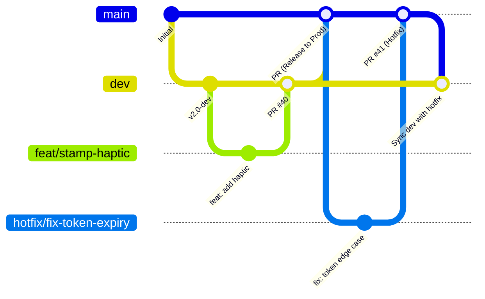
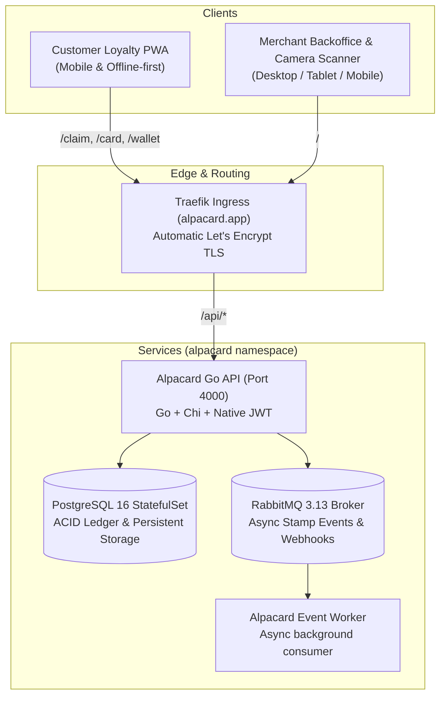

# Alpacard 🦙

> **Open-Source Digital Loyalty Punch Cards & Menus for Local Businesses.**  
> Self-hosted, decoupled, ultra-lightweight, and zero SaaS subscription fees.

[](LICENSE)
[](https://go.dev/)
[](https://react.dev/)
[](https://developer.mozilla.org/en-US/docs/Web/Progressive_web_apps)
[](https://kubernetes.io/)
[](CONTRIBUTING.md)

---

## 🌐 Environments & Domains

| Environment | Purpose | Target Audience | URLs & Access | Security & Network |
| :--- | :--- | :--- | :--- | :--- |
| **Production** | Live Merchant & Customer traffic | Coffee shops, retail merchants & cardholders | • **Landing & Merchant**: [https://alpacard.app](https://alpacard.app)<br/>• **Customer Wallet**: [https://alpacard.app/wallet](https://alpacard.app/wallet)<br/>• **Interactive Demo**: [https://alpacard.app/demo](https://alpacard.app/demo)<br/>• **REST API**: `https://alpacard.app/api` | Public internet, Cloudflare proxy, automated Let's Encrypt TLS multi-SAN certificates |
| **Development / Non-Prod** | Pre-release testing, staging & QA validation | Core team, QA testers, beta merchants | • **Merchant Console**: [https://dev.alpacard.app](https://dev.alpacard.app)<br/>• **Customer Wallet**: [https://dev.alpacard.app/wallet](https://dev.alpacard.app/wallet)<br/>• **Dev API**: `https://dev.alpacard.app/api`<br/>• *(Fallback local)*: `http://dev.alpacard.local` | **Zero public internet exposure**. Accessible strictly via secure **Tailscale VPN** subnet router (`192.168.0.0/24`) with valid Let's Encrypt TLS. Dedicated isolated database (`alpacard_dev`), RabbitMQ broker, and isolated k8s namespace (`alpacard-dev`). |

---

## 🌿 Branching Strategy & Workflow

We follow a clean, structured **Gitflow / GitHub Flow hybrid** optimized for rapid feature development and zero-downtime production releases:



### 1. Permanent Branches
- **`main` (Production)**:
  - Reflects the live production state running on `https://alpacard.app`.
  - **Protected branch**: Direct pushes and force pushes are blocked.
  - Deployments trigger automatically to the production Kubernetes namespace (`alpacard`).
- **`dev` (Development / Staging Integration)**:
  - Serves as the primary integration branch for new features and non-breaking improvements.
  - Deployed to the isolated `alpacard-dev` environment (`https://dev.alpacard.app`) for QA and pre-release validation.
  - **Protected branch**: Direct pushes and force pushes are blocked.

### 2. Supporting Topic Branches
All work must happen on dedicated short-lived branches created from `dev` (or `main` in case of critical hotfixes):

| Branch Prefix | Convention | Source Branch | Target Branch | Description |
| :--- | :--- | :--- | :--- | :--- |
| `feat/` | `feat/<short-description>` | `dev` | `dev` | New capabilities, UI flows, and non-breaking enhancements. |
| `fix/` | `fix/<short-description>` | `dev` | `dev` | Bug fixes and UX corrections verified in QA before prod. |
| `hotfix/` | `hotfix/<short-description>` | `main` | `main` & `dev` | Critical production issues requiring immediate patch release. |
| `chore/` | `chore/<short-description>` | `dev` | `dev` | Tooling, dependencies, refactors, and documentation updates. |

### 3. Contribution Rules & Pull Request Guidelines
1. **Branch Protection**:
   - Both `main` and `dev` require all changes to arrive through GitHub Pull Requests (`gh pr create`).
   - Direct pushes and force-pushes (`git push --force`) are strictly prohibited.
2. **Conventional Commits**:
   - Commit messages must follow conventional commits: `feat(...)`, `fix(...)`, `chore(...)`, `docs(...)`, `test(...)`.
3. **Automated CI Validation**:
   - Every Pull Request against `dev` or `main` automatically runs Go backend builds (`go build ./cmd/server ./cmd/worker`), Node dependency validation (`pnpm build`), and frontend builds.
4. **Isolated Data Safety**:
   - Test changes exclusively against `alpacard-dev` / `dev.alpacard.app`. Never run migrations, seed data, or experimental API calls against production without prior review.

---

## ✨ Features

- 📱 **Zero App-Store Friction for Customers**:
  - Customers scan a counter QR code directly with their standard phone camera.
  - Generates an instant, anonymous guest wallet PWA—no app download or email signup required while waiting in line.
  - Customers can optionally register anytime to sync cards across all their devices.

- 🎨 **Deep Card Personalization**:
  - Custom merchant logos, brand color presets (Espresso Roast, Charcoal Slate, Forest Matcha, etc.), and custom hex colors.
  - Background image uploading with fit modes: `contain` (centered), `cover` (full bleed), or `watermark` with custom base tints.
  - Custom stamp icons: `coffee`, `star`, `sparkle`, `heart`, `gift`, `cupcake`, `crown`, and `tag`.

- 📖 **Integrated Business Menus**:
  - Link directly to external drive/website menus.
  - Upload 10MB PDF or image menus with in-wallet viewer.
  - Built-in interactive digital menu builder with categorized items and price tags.
  - One-tap `[ 📖 Ver Menú ]` button directly visible on the customer's punch card.

- 🔒 **Tamper-Proof Single-Use Anti-Replay Tokens**:
  - Dynamic QR codes generated with rotating 5-minute cryptographic tokens.
  - Atomic PostgreSQL transactions prevent token replay attacks or duplicate stamps.

- 📷 **Universal Camera Scanner**:
  - Cashiers and baristas scan customer QR codes using any device with a camera (phone, tablet, or web scanner) with instant sound and haptic confirmation.

- 🏢 **Multi-Merchant Wallet**:
  - Customers keep cards from all their favorite local coffee shops, bakeries, and stores organized in one clean wallet.

---

## 🏛️ Architecture Overview

Alpacard is built as a high-performance **Turborepo monorepo**:

```
alpacard/
├── apps/
│   ├── api/             # High-performance Go REST API & RabbitMQ consumer (~20MB RAM)
│   ├── web/             # Merchant Backoffice, Design Studio & QR Scanner (Vite + React)
│   └── wallet/          # Customer Mobile PWA (Offline-first, 1-click claim, dynamic QR)
├── packages/
│   └── shared/          # Shared TypeScript models, themes, and card presets
├── deploy/
│   ├── docker-compose.yml # 1-command local development stack (Postgres + RabbitMQ + Apps)
│   └── helm/alpacard/   # Production Helm chart for Kubernetes & Cloud Native
└── docs/
    └── marketing/       # Free community marketing guides, Reddit posts, and launch calendar
```



---

## 💻 Local Quickstart

### 1-Command Docker Compose (Full Stack)

```bash
docker compose -f deploy/docker-compose.yml up --build
```

- **Merchant Backoffice**: [http://localhost:5173](http://localhost:5173)
- **Customer Wallet**: [http://localhost:5174](http://localhost:5174)
- **Go REST API**: [http://localhost:4000](http://localhost:4000)
- **RabbitMQ Dashboard**: [http://localhost:15672](http://localhost:15672) (`guest` / `guest`)

---

## 🤝 Contributing & Community

We are actively seeking collaborators, beta testers, and community maintainers!

- **Developers**: Check out [CONTRIBUTING.md](CONTRIBUTING.md) for local dev setup, good first issues, and PR guidelines.
- **Beta Testers & QA**: Test our camera QR scanner on different phones and report bugs using our [Issue Templates](.github/ISSUE_TEMPLATE/).
- **Local Business Outreach**: Check [docs/marketing/](docs/marketing/) for launch posts, Reddit templates, and local store pitch scripts.

---

## 📄 License

GNU Affero General Public License v3.0 (AGPL-3.0). See [LICENSE](LICENSE) for details.  
Copyright (c) 2026 Gabriel Cavallo.

Free for personal and self-hosted use. Any modified versions operated as a network service or cloud offering must provide their complete corresponding source code under the same AGPL-3.0 license.
