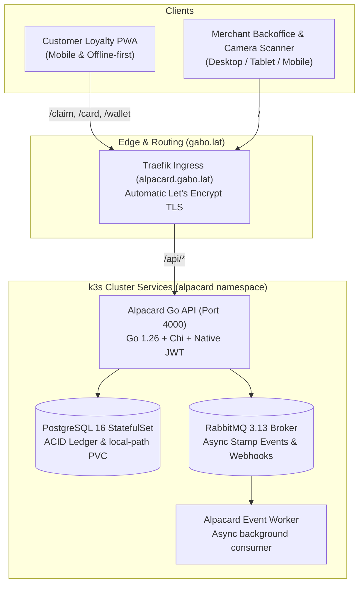

# Alpacard (v2 Monorepo)

A self-hosted, decoupled digital punch card & loyalty platform built for high performance, zero cloud lock-in, and homelab Kubernetes deployment.

---

## 1. Architecture Overview

Alpacard has been refactored from a monolithic Next.js app into a decoupled **Turborepo monorepo**:

```
alpacard/
├── apps/
│   ├── api/             # High-performance Go 1.26 REST API & RabbitMQ consumer
│   ├── web/             # Merchant Backoffice & QR Camera Scanner (Vite + React)
│   └── wallet/          # Customer Mobile PWA (Offline-first, 1-click claim, dynamic QR)
├── packages/
│   └── shared/          # Shared TypeScript models and API types
├── deploy/
│   ├── docker-compose.yml # 1-command local development stack (Postgres + RabbitMQ + Apps)
│   └── k3s/             # Production Kubernetes manifests for homelab k3s
└── legacy/
    └── next-monolith/   # Preserved legacy Next.js / Clerk / MongoDB implementation
```



---

## 2. Key Improvements over v1

1. **Vendor Independence**: Completely eliminated **Clerk** (closed-source SaaS) and **Vercel** serverless dependencies. Authentication is now 100% self-hosted using bcrypt password hashing, standard JWTs, and role-based access control (`CONSUMER`, `STAFF`, `OWNER`).
2. **Replay Attack Elimination**: v1 generated dynamic 5-minute QR tokens, but never tracked whether a token was already scanned. v2 introduces **single-use JTI tracking** in an atomic PostgreSQL transaction. Scanning the same QR twice immediately results in a `409 Conflict: This QR code has already been scanned`.
3. **Zero-Friction Customer Experience**: Customers scanning an acquisition poster at checkout no longer have to register with email or passwords while in line. An anonymous consumer wallet is generated instantly via `/api/v1/auth/guest` and saved in `localStorage`/IndexedDB.
4. **Relational Database Integrity**: Migrated from MongoDB to **PostgreSQL** (with optional **SQLite** support for zero-config local development). Foreign keys and ACID transactions ensure stamp increments and transaction records are atomic.
5. **Decoupled Event Processing**: Integrated **RabbitMQ** to publish stamp events (`EARN` and `REDEEM`) asynchronously for future notification dispatch, analytics pipelines, and CRM webhooks.
6. **Ultra-Low Memory Footprint**: The Go API compiles to a native static binary running with only **~15–25MB of RAM** (compared to 250MB+ for Node/Python), making it ideal for running alongside other apps on homelab k3s nodes.

---

## 3. Local Development

### Option A: 1-Command Docker Compose (Full Stack)
To run PostgreSQL, RabbitMQ, Go API, Worker, Merchant Web, and Customer Wallet:

```bash
docker compose -f deploy/docker-compose.yml up --build
```

- **Merchant Backoffice**: [http://localhost:5173](http://localhost:5173)
- **Customer Wallet**: [http://localhost:5174](http://localhost:5174)
- **Go REST API**: [http://localhost:4000](http://localhost:4000)
- **RabbitMQ Management**: [http://localhost:15672](http://localhost:15672) (User: `guest`, Pass: `guest`)

---

### Option B: Native Development (Zero-Docker / SQLite)

1. **Install dependencies**:
   ```bash
   pnpm install
   ```

2. **Start the Go API (uses SQLite automatically)**:
   ```bash
   cd apps/api
   go run cmd/server/main.go
   ```

3. **Start the Frontend applications**:
   ```bash
   pnpm dev
   ```

---

## 4. Homelab k3s Deployment (`alpacard.gabo.lat`)

The Kubernetes manifests in `deploy/k3s/` are pre-configured for your k3s cluster (`traefik`, `local-path` storage class, and `letsencrypt-prod` cluster issuer):

### 1. Apply Manifests
```bash
# 1. Create namespace
kubectl apply -f deploy/k3s/00-namespace.yaml

# 2. Deploy PostgreSQL StatefulSet with persistent storage
kubectl apply -f deploy/k3s/01-postgres.yaml

# 3. Deploy RabbitMQ
kubectl apply -f deploy/k3s/02-rabbitmq.yaml

# 4. Deploy Go API and background worker
kubectl apply -f deploy/k3s/03-api.yaml

# 5. Deploy Frontend apps (Merchant Backoffice & Customer Wallet)
kubectl apply -f deploy/k3s/04-frontend.yaml

# 6. Deploy Traefik Ingress with automatic Let's Encrypt SSL
kubectl apply -f deploy/k3s/05-ingress.yaml
```

### 2. Verify Pods & TLS Certificate
```bash
kubectl get pods,svc,ingress -n alpacard
kubectl get certificate -n alpacard
```

---

## 5. Security Architecture

- **Auth Tokens**: Standard HMAC-SHA256 JWTs with 30-day expiration for merchant/staff sessions.
- **Dynamic QR Tokens**: 5-minute expiration HMAC-SHA256 tokens containing `{ type: "stamp", cardId, userId, campaignId, nonce, jti }`.
- **Atomic Concurrency Protection**: Transactions use PostgreSQL row locking (`gorm.DB.Transaction`) to verify the unique JTI before incrementing stamps or resetting on redemption.
