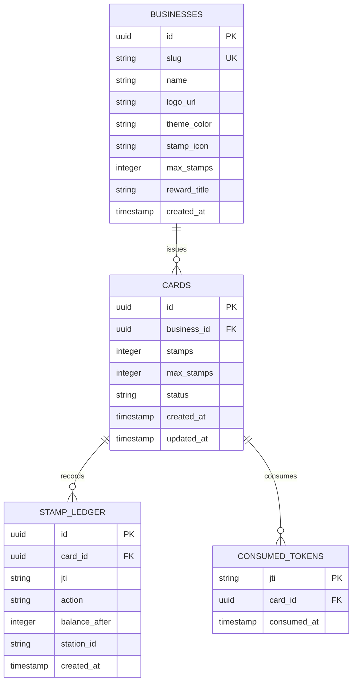

# 📊 API Reference & Data Models

This page documents the RESTful HTTP API contracts, PostgreSQL database schema definitions, and asynchronous RabbitMQ event envelopes used across Alpacard.

---

## 🌐 REST API Endpoints

### 1. Health & Telemetry

#### `GET /api/health`
Kubernetes readiness and liveness probe endpoint.

* **Response (`200 OK`)**:
```json
{
  "status": "healthy",
  "service": "alpacard-api",
  "time": "2026-10-26T20:25:00Z"
}
```

#### `GET /metrics`
Standard Prometheus metrics endpoint providing scraping telemetry:
* `alpacard_http_requests_total{handler, code}`: Total processed API requests.
* `alpacard_scan_duration_seconds`: Histogram of scan transaction latency.
* `alpacard_db_pool_connections{state}`: PostgreSQL connection pool saturation.

---

### 2. Card Management

#### `POST /api/v1/cards/claim`
Issues a new loyalty card instance to a customer without requiring account registration.

* **Request Body**:
```json
{
  "businessSlug": "cafe-alpaca"
}
```

* **Response (`201 Created`)**:
```json
{
  "cardId": "b8f1d742-1e9a-4c28-98e3-0c4a7f921d3e",
  "businessName": "Café Alpaca",
  "stamps": 0,
  "maxStamps": 10,
  "rewardTitle": "Café de Especialidad Gratis",
  "themeColor": "#3D2B1F",
  "stampIcon": "coffee",
  "createdAt": "2026-10-26T20:25:00Z"
}
```

#### `GET /api/v1/cards/:id`
Retrieves current card balance, business metadata, and reward status.

* **Response (`200 OK`)**:
```json
{
  "cardId": "b8f1d742-1e9a-4c28-98e3-0c4a7f921d3e",
  "businessSlug": "cafe-alpaca",
  "businessName": "Café Alpaca",
  "stamps": 7,
  "maxStamps": 10,
  "isRewardReady": false,
  "stampsRemaining": 3,
  "themeColor": "#3D2B1F",
  "stampIcon": "coffee"
}
```

---

### 3. Stamp Issuance & Cashier Verification

#### `POST /api/v1/stamps/scan`
Validates a dynamic customer QR token, checks anti-replay JTI nonces, updates card balance atomically, and returns the result to the cashier scanner.

* **Request Body**:
```json
{
  "token": "eyJhbGciOiJIUzI1NiIsInR5cCI6IkpXVCJ9.eyJjYXJkX2lkIjoiYjhmMWQ3NDItMWU5YS00YzI4LTk4ZTMtMGM0YTdmOTIxZDNlIiwianRpIjoibm9uY2VfYTFiMmMzZDRlNWY2IiwiaWF0IjoxNzkzMDU2ODAwLCJleHAiOjE3OTMwNTY4MzB9.signature..."
}
```

* **Success Response (`200 OK` - Stamp Earned)**:
```json
{
  "success": true,
  "action": "EARN",
  "newCount": 8,
  "message": "¡Sello sumado con éxito!"
}
```

* **Success Response (`200 OK` - Reward Redeemed)**:
```json
{
  "success": true,
  "action": "REDEEM",
  "newCount": 0,
  "message": "¡Premio canjeado exitosamente!"
}
```

* **Error Response (`409 Conflict` - Replay Attack Caught)**:
```json
{
  "error": "JTI Already Consumed",
  "code": "TOKEN_REPLAY_DETECTED",
  "message": "Este código QR ya fue utilizado previamente."
}
```

* **Error Response (`401 Unauthorized` - Expired Token)**:
```json
{
  "error": "Token Expired",
  "code": "TOKEN_EXPIRED",
  "message": "El código QR ha expirado. Espera a que el cliente actualice la pantalla."
}
```

---

## 🗄️ PostgreSQL Database Schema



### Table DDL Highlights

```sql
-- Consumed tokens table with primary key index for sub-millisecond replay lookups
CREATE TABLE IF NOT EXISTS consumed_tokens (
    jti VARCHAR(64) PRIMARY KEY,
    card_id UUID NOT NULL REFERENCES cards(id) ON DELETE CASCADE,
    consumed_at TIMESTAMPTZ NOT NULL DEFAULT NOW()
);

-- Immutable audit ledger recording every balance change
CREATE TABLE IF NOT EXISTS stamp_ledger (
    id UUID PRIMARY KEY DEFAULT gen_random_uuid(),
    card_id UUID NOT NULL REFERENCES cards(id) ON DELETE CASCADE,
    jti VARCHAR(64) NOT NULL,
    action VARCHAR(16) NOT NULL CHECK (action IN ('EARN', 'REDEEM', 'ADJUST')),
    balance_after INTEGER NOT NULL,
    station_id VARCHAR(64),
    created_at TIMESTAMPTZ NOT NULL DEFAULT NOW()
);
CREATE INDEX idx_stamp_ledger_card ON stamp_ledger(card_id, created_at DESC);
```

---

## 📨 RabbitMQ Asynchronous Event Contracts

When a stamp transaction commits in PostgreSQL, an asynchronous message is published to the `stamps.exchange` topic exchange:

### Routing Key: `stamp.earned`
```json
{
  "eventId": "evt_4a8b2c1d-0e9f-4b3a",
  "timestamp": "2026-10-26T20:25:01Z",
  "cardId": "b8f1d742-1e9a-4c28-98e3-0c4a7f921d3e",
  "businessSlug": "cafe-alpaca",
  "action": "EARN",
  "amount": 1,
  "balanceAfter": 8,
  "stationId": "terminal-counter-1"
}
```

### Routing Key: `stamp.redeemed`
```json
{
  "eventId": "evt_9f8e7d6c-5b4a-3e2d",
  "timestamp": "2026-10-26T20:30:15Z",
  "cardId": "b8f1d742-1e9a-4c28-98e3-0c4a7f921d3e",
  "businessSlug": "cafe-alpaca",
  "action": "REDEEM",
  "rewardTitle": "Café de Especialidad Gratis",
  "balanceAfter": 0,
  "stationId": "terminal-counter-1"
}
```
