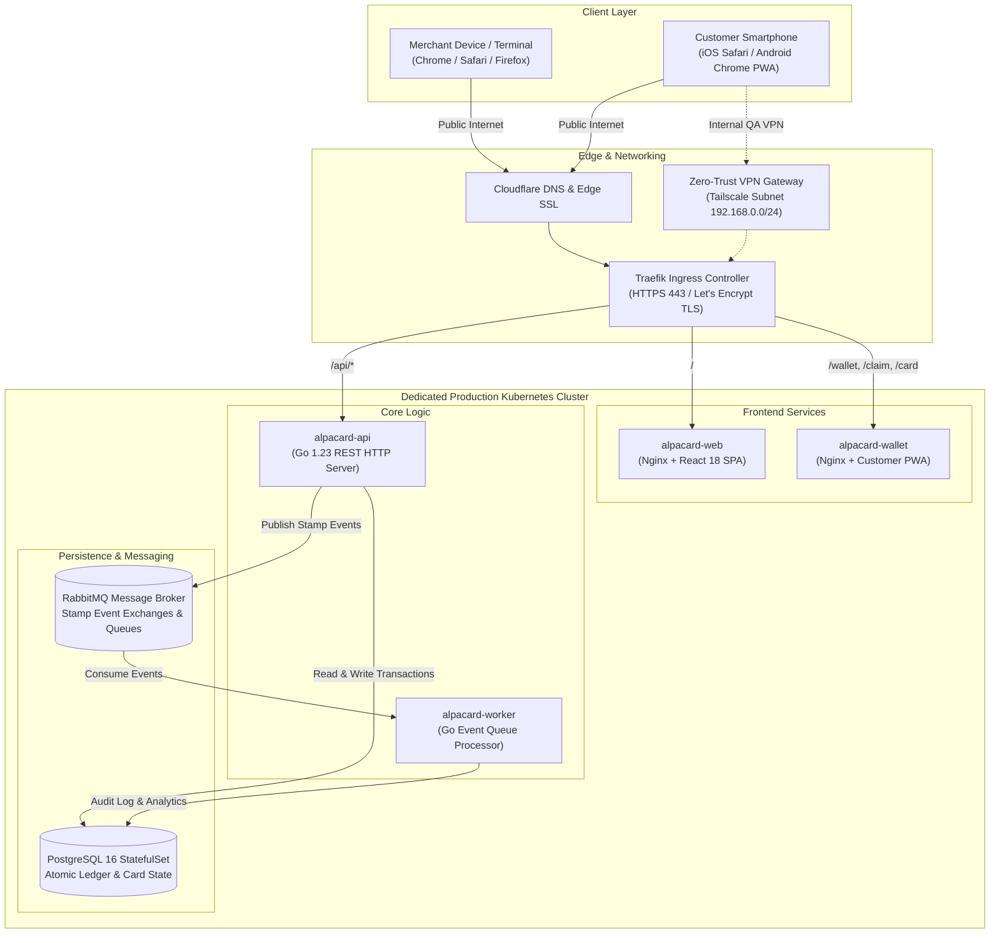
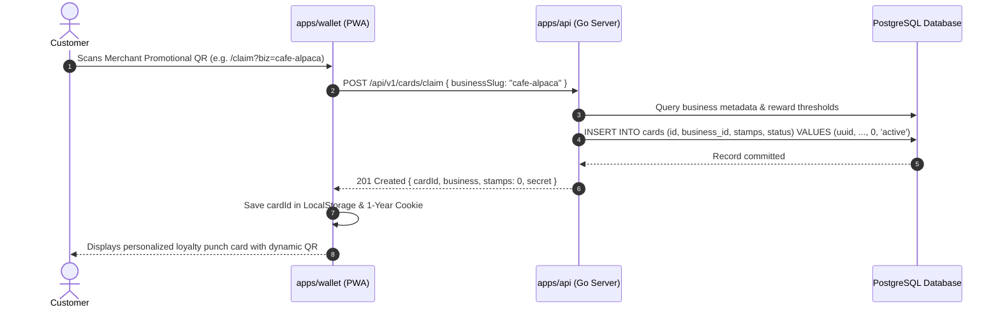
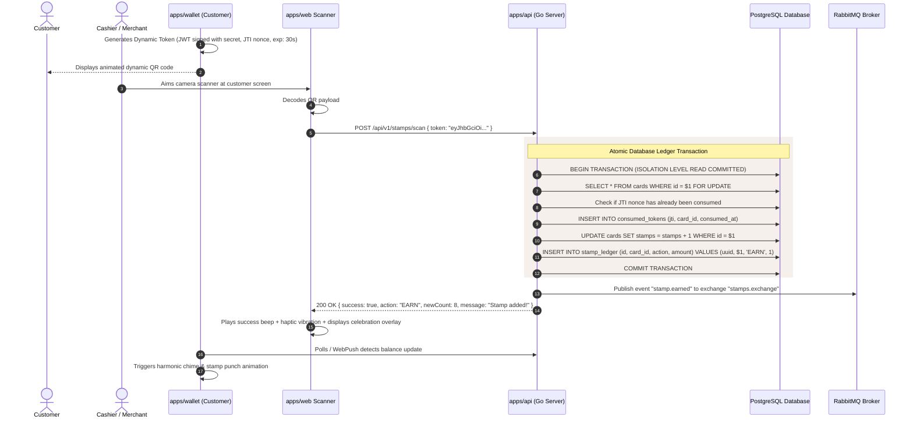

# 🏗️ Architecture Overview

The Alpacard ecosystem is engineered as a **decoupled, event-driven microservices architecture** that balances sub-millisecond cashier scanning latency with absolute transaction integrity and fraud resilience.

---

## 🏛️ System Architecture Diagram

---

## 📦 Service Responsibilities

### 1. `apps/api` (Go REST API Server)
* **Runtime**: Go 1.23+ compiled statically without CGO (`CGO_ENABLED=0 GOOS=linux`).
* **Router**: Standard library `net/http` router with zero external routing dependencies for maximum performance and minimum memory footprint (~18MB resident memory).
* **Core Endpoints**:
  * `GET /api/health`: Health probe and service metadata for Kubernetes liveness/readiness probes.
  * `POST /api/v1/cards/claim`: Issues a new digital card to a customer without requiring login credentials.
  * `POST /api/v1/cards/token`: Generates a dynamic, cryptographically signed, short-lived JWT/HMAC token for customer display.
  * `POST /api/v1/stamps/scan`: Validates token signatures, enforces anti-replay JTI checks, increments stamps atomically, and commits ledger transactions.
  * `GET /metrics`: Native Prometheus metrics endpoint reporting request rates, scan latency histograms, and database pool utilization.

### 2. `apps/api/cmd/worker` (Go Asynchronous Worker)
* **Message Broker**: Subscribes to RabbitMQ topic exchange `stamps.exchange`.
* **Asynchronous Jobs**:
  * Decouples heavy audit logging, analytics aggregation, and merchant notification processing from the cashier's critical latency path.
  * Employs dead-letter exchanges (`stamps.dlx`) and exponential backoff retry policies to guarantee zero lost transactions during downstream network partitions.

### 3. `apps/web` (Merchant Backoffice & Scanner)
* **Tech Stack**: React 18, Vite 6, Tailwind CSS 4, Lucide Icons.
* **Capabilities**:
  * **Interactive Demo**: Tour illustrating cashier camera scanning and customer stamp animations side by side.
  * **Camera Scanner**: Integrated hardware scanner powered by `@yudiel/react-qr-scanner` with torch flashlight control, zoom factor adjustment, and instant visual/haptic/audio confirmation.
  * **Card & Campaign Customizer**: Visual color picker, custom logo uploader, stamp icon selector, and reward milestone definition.

### 4. `apps/wallet` (Customer Offline-First PWA)
* **Tech Stack**: React 18, Vite 6, Tailwind CSS 4, Web Audio API.
* **Key Features**:
  * **Zero App-Store Friction**: Opens instantly via QR scan or URL without downloading an APK or native app.
  * **Dynamic Anti-Screenshot QR**: Re-generates single-use tokens every 30 seconds with an animated countdown dial.
  * **Cookie & LocalStorage Persistence**: Stores card session IDs in 1-year persistent cookies (`SameSite=Lax`) to prevent customer card loss on accidental tab close or page reload.
  * **Native Web Audio Synthesizer**: Generates crisp harmonic chime tones on stamp receipt and fanfare chords on reward redemption without external MP3 asset latency.

### 5. `packages/shared` (Shared TypeScript Contract)
* Monorepo workspace library consumed by `apps/web` and `apps/wallet`.
* Contains strict TypeScript interfaces for `Business`, `Card`, `StampAction`, `ScanResult`, and canonical stamp icon identifiers (`coffee`, `pizza`, `scissors`, `taco`, etc.).

---

## 🔄 Core Transaction Workflows

### Workflow 1: Customer Card Claim & Provisioning

---

### Workflow 2: Merchant Cashier Scan & Stamp Issuance

