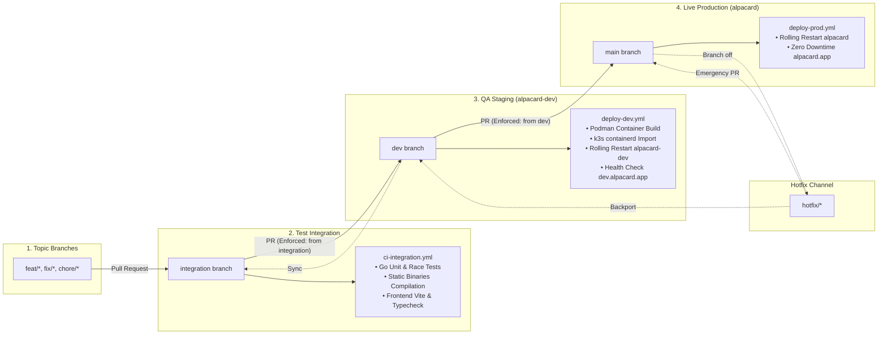

# 🌿 Branching Strategy & CI/CD Pipelines

Alpacard enforces an automated **Gitflow / GitHub Flow hybrid with Pipeline Gatekeepers** to maintain zero-downtime production deployments, isolated pre-release QA validation, and continuous automated test verification.

---

## 🏛️ Promotion Lifecycle Diagram



---

## 📌 Permanent Branch Matrix

| Branch | Environment | Accessibility | Allowed PR Source | Automated Pipelines |
| :--- | :--- | :--- | :--- | :--- |
| **`integration`** | CI Test Harness | Internal GitHub Actions | Feature branches (`feat/*`, `fix/*`, `chore/*`) | **`ci-integration.yml`**: Runs full Go test suite with `-race` flag, Go binary builds, and frontend builds. |
| **`dev`** | `alpacard-dev` k8s | Tailscale VPN ([dev.alpacard.app](https://dev.alpacard.app)) | **Strictly `integration`** | **`branch-rules.yml`**: Gatekeeper blocking unauthorized PRs.<br/>**`deploy-dev.yml`**: Automated zero-downtime rollout to dev namespace. |
| **`main`** | `alpacard` k8s | Public Internet ([alpacard.app](https://alpacard.app)) | **`dev`** *(or `hotfix/*`)* | **`branch-rules.yml`**: Gatekeeper blocking unauthorized PRs.<br/>**`deploy-prod.yml`**: Automated zero-downtime rollout to production namespace. |

---

## 🛡️ Automated Gatekeeper: `branch-rules.yml`

Every Pull Request targeting `dev` or `main` is evaluated by an automated GitHub Action gatekeeper:

1. **Target: `dev`**:
   - Evaluates `github.head_ref`.
   - If the source branch is not `integration`, the check fails immediately:
     ```
     ❌ Branch Strategy Violation: Pull Requests targeting 'dev' MUST originate from 'integration'.
     ```
2. **Target: `main`**:
   - Evaluates `github.head_ref`.
   - If the source branch is not `dev` and does not start with `hotfix/`, the check fails:
     ```
     ❌ Branch Strategy Violation: Pull Requests targeting 'main' (Production) MUST originate from 'dev' or 'hotfix/*'.
     ```

---

## 🤖 Self-Hosted Deployment Runner Architecture

Deployments run through a dedicated GitHub Actions self-hosted runner registered on the local Kubernetes host (`xeon-k3s-runner`):

* **Service**: `actions.runner.Gabmetal-alpacard-web.xeon-k3s-runner.service` (managed via systemd).
* **Labels**: `self-hosted`, `alpacard-k8s`, `linux`, `x64`.
* **Security Benefits**:
  * Kubernetes control-plane API is **never exposed** to the public internet.
  * Container images are built locally with Podman and piped directly into `k3s containerd` (`podman save | sudo k3s ctr images import -`), requiring zero external registry pushes and zero external network bandwidth consumption.

---

## 📜 Unified Deployment Script: `scripts/deploy-env.sh`

Deployments are executed uniformly via the version-controlled script [`scripts/deploy-env.sh`](file:///home/gabo/Documents/antigravity/bold-franklin/scripts/deploy-env.sh):

```bash
# Manual deployment syntax (if needed by SRE)
./scripts/deploy-env.sh dev    # Deploys to alpacard-dev namespace
./scripts/deploy-env.sh prod   # Deploys to alpacard namespace
```

### Script Execution Steps:
1. Installs frozen dependencies and compiles shared packages and frontend bundles (`pnpm build`).
2. Statically compiles Go API and Worker binaries (`CGO_ENABLED=0 GOOS=linux`).
3. Builds container images (`alpacard-web`, `alpacard-wallet`, `alpacard-api`).
4. Imports images into local `k3s containerd`.
5. Triggers a rolling restart across the target Kubernetes deployments.
6. Waits for rollout completion (`kubectl rollout status deployment/...`).
7. Executes an automated HTTP 200 smoke test against the live domain.
