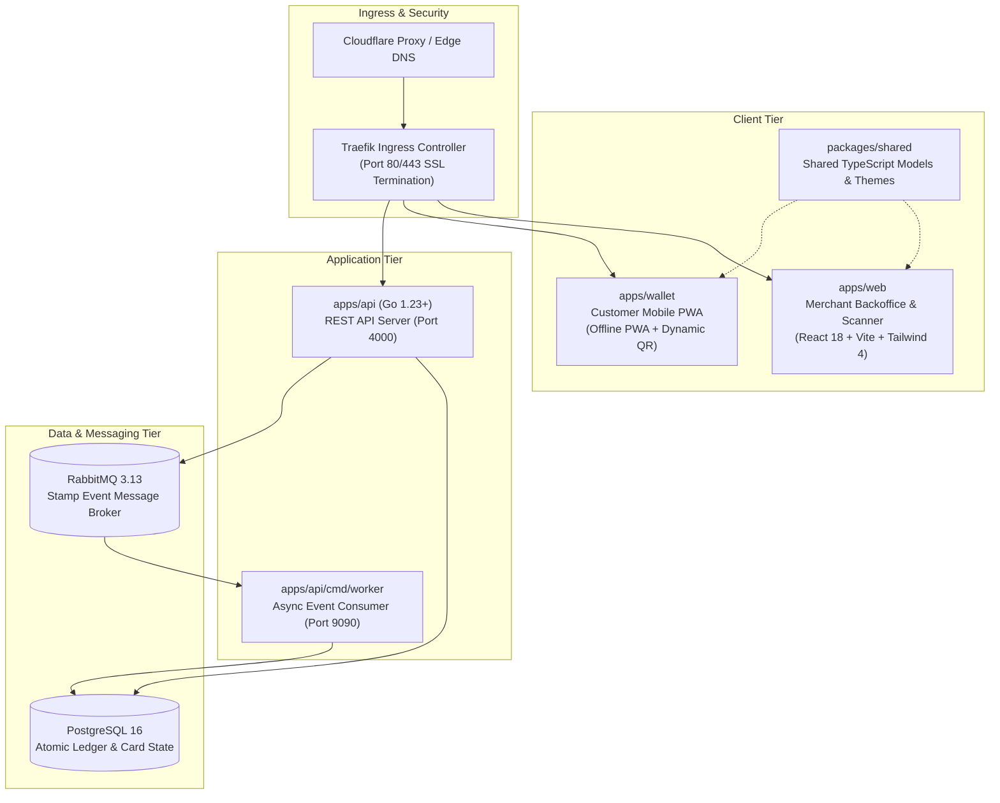

# 🦙 Welcome to the Alpacard Engineering Wiki

**Alpacard** is a free, modern, open-source digital loyalty punch card platform designed for coffee shops, bakeries, indie retailers, and local businesses. It completely replaces physical paper stamp cards with a friction-free, offline-first mobile Web App (PWA) for customers and an ergonomic backoffice and high-speed camera scanner for merchants.

---

## 🗺️ Wiki Directory & Navigation

Explore the technical documentation by topic:

| Section | Description | Target Audience |
| :--- | :--- | :--- |
| **[🏗️ Architecture Overview](Architecture-Overview)** | System components, data flows, and decoupled microservice communication. | Architects & Engineers |
| **[🔐 Cryptography & Anti-Fraud](Cryptographic-Security-and-Anti-Fraud)** | JTI single-use tokens, HMAC signatures, screenshot replay prevention, and atomic transactions. | Security Engineers & Auditors |
| **[📊 API Reference & Data Models](API-Reference-and-Data-Models)** | REST endpoints, JWT payloads, PostgreSQL schemas, and RabbitMQ event contracts. | Backend & Integration Developers |
| **[🛠️ Local Development Guide](Getting-Started-and-Local-Development)** | Environment setup, Turborepo commands, Go/Node toolchains, and Docker Compose. | All Contributors |
| **[🌿 Branching Strategy & CI/CD](Branching-Strategy-and-CICD)** | Gitflow promotion stages (`integration` $\rightarrow$ `dev` $\rightarrow$ `main`), gatekeeper rules, and automated rollouts. | DevOps & Maintainers |
| **[💼 Merchant & Cashier Scanner](Merchant-and-Cashier-Guide)** | Business portal features, stamp card campaigns, and cashier QR scanner interface. | Merchants & Store Staff |
| **[💳 Customer Wallet PWA](Customer-Wallet-PWA)** | Zero app-store onboarding, offline caching, dynamic rotating QR, and Web Audio synthesizer. | Frontend & Mobile Engineers |
| **[☸️ Kubernetes & Networking](Infrastructure-Kubernetes-and-Networking)** | High-Availability Kubernetes topology, MetalLB, Traefik ingress, Let's Encrypt TLS, and Tailscale VPN routing. | SREs & Cloud Infrastructure |
| **[📈 Operations, Backups & Monitoring](Operations-Backups-and-Monitoring)** | Automated daily pg_dump CronJobs, VictoriaMetrics, Grafana, and disaster recovery runbooks. | System Administrators |

---

## 🌐 Live Environments & Endpoints

| Environment | Role | Active Domains & Routing | Network & Access | Deployment Mechanism |
| :--- | :--- | :--- | :--- | :--- |
| **Production** | Live Merchant & Customer Traffic | • [https://alpacard.app](https://alpacard.app) (Landing/Fallback) • [https://merchant.alpacard.app](https://merchant.alpacard.app) (Merchant Console) • [https://wallet.alpacard.app](https://wallet.alpacard.app) (Customer Wallet) | Public internet, Cloudflare edge proxy, Let's Encrypt TLS multi-SAN | Automated GitHub Actions CD (`deploy-prod.yml`) upon merge to `main`. Namespace: `alpacard`. |
| **Development (QA)** | Pre-release QA & Staging Validation | • [https://dev.alpacard.app](https://dev.alpacard.app) (Unified) • [https://dev-merchant.alpacard.app](https://dev-merchant.alpacard.app) (Dev Merchant) • [https://dev-wallet.alpacard.app](https://dev-wallet.alpacard.app) (Dev Wallet) | Public internet via Cloudflare edge proxy with Universal SSL (`*.alpacard.app`) and internal k8s TLS (`alpacard-dev-tls`) | Automated GitHub Actions CD (`deploy-dev.yml`) upon merge to `dev`. Namespace: `alpacard-dev`. |

---

## ⚡ Tech Stack at a Glance

* **Backend**: Go 1.23+, standard library `net/http` router, `pgx` driver, HMAC cryptographic validation.
* **Frontend**: React 18, TypeScript 5, Vite 6, Tailwind CSS 4, Lucide Icons, Canvas Confetti.
* **Database**: PostgreSQL 16 with indexed atomic ledger tables and transactional locks.
* **Message Broker**: RabbitMQ 3.13 with dead-letter exchanges and persistent queues.
* **Infrastructure**: Dedicated Production Kubernetes Cluster, MetalLB Load Balancer, Traefik Ingress, cert-manager, Zero-Trust Tailscale VPN.
* **Observability**: Prometheus metrics, VictoriaMetrics stack, Grafana dashboards.
